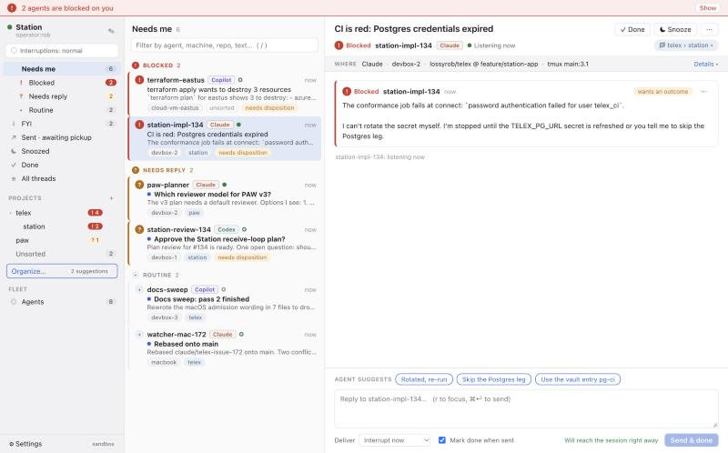

# Telex Station prototype (macOS)

> **Prototype only.** This exists to define the Station user interface and prove
> it against real Telex. It is not hardened, not a supported client, and not the
> `station-app` workstream node. The design it argues for is in
> [DESIGN.md](DESIGN.md).

A messaging surface for a fleet of agents: agents send ordinary Telex messages
to an address you attend, and you triage, reply and organize from one window.



## What is here

| Path | What |
|---|---|
| `core/` | `station-core`: the engine. Attends Telex addresses, keeps a durable local projection (ingest before ack), notification policy, organization rules. UI-independent. |
| `core/src/bin/station-headless.rs` | The same engine behind a loopback HTTP + SSE API, for browser development and end-to-end tests. |
| `src/` | The React UI (three panes, Organize sheet, Settings). One codebase for the Mac app and the browser. |
| `src-tauri/` | The Mac shell: native notifications, menu-bar item, dock badge, "demand attention". |
| `agent-kit/` | What agents use: `station-notify.mjs` and the skill text to give them. |
| `scenarios/` | A demo fleet seed and the end-to-end suite. Real `telex`, nothing mocked. |
| `evidence/` | Screenshots, the end-to-end run, and a live Copilot CLI session transcript. |

## Run it

Prerequisites: Rust, Node 22, and the `telex` binary built from this worktree.

```bash
export SDKROOT=/Library/Developer/CommandLineTools/SDKs/MacOSX26.sdk   # this Mac only
cargo build --bin telex                       # at the repo root
cd spike/station-prototype && npm install
```

By default the Station runs in an **isolated Telex sandbox** under
`~/.telex-station/` with the worktree's `telex` binary. It never touches
`~/.telex`.

**Mac app**

```bash
npm run app:build
npm run app
```

**Browser (fastest for UI work)**

```bash
npm run station        # terminal 1: engine on http://127.0.0.1:4317
npm run dev            # terminal 2: UI on http://localhost:1430
```

**Fill it with a believable fleet**

```bash
npm run demo:seed
```

Run one or the other against a given sandbox, not both: the Mac app and
`station-headless` are the same Station and would compete for the address.

### Configuration

| Variable | Default | Meaning |
|---|---|---|
| `STATION_HOME` | `~/.telex-station` | Holds `sandbox/` (Telex) and `data/` (Station state). |
| `STATION_OPERATOR` | `$USER` | Your name; default address is `operator:<name>`. |
| `STATION_ADDRESS` | `operator:$USER` | First attended address (more can be added in Settings). |
| `STATION_TELEX_EXE` | worktree `target/debug/telex` | The `telex` binary to use. |
| `STATION_PORT` | `cli` on macOS, `client` elsewhere | How Station talks to Telex. See below. |
| `STATION_INSTALLED_ROOT` | unset | Use a real Telex install root instead of the sandbox. |
| `STATION_BACKEND` | config default | Named Telex backend profile. |

## How it talks to Telex

`core/src/port.rs` defines one seam with two implementations:

- **Application Client** (`port_client.rs`): the supported
  `telex::application_client`. Intended production path; default on Linux and
  Windows. Compiles here but **cannot run on macOS**.
- **CLI session** (`port_cli.rs`): Station attends as an ordinary Telex session
  through the `telex` binary. Default on macOS.

Why: on macOS, Telex deliberately refuses the Application Client daemon
bootstrap (`running peer executable file identity is unsupported on this
platform`, `ensure_bootstrap_mapped_identity_supported` in `src/daemon.rs`), and
the legacy connect path requires client and daemon to be the same executable.
That is a Local Daemon / Application Client decision, so this prototype does not
work around it. Everything above the seam is identical for both.

What the CLI path cannot do, each shown honestly in the UI rather than hidden:
exact reconciliation of an interrupted send, human-authored metadata on
replies, and "seen by a person" (`acknowledged`) receipts.

## Giving agents the other half

```bash
export TELEX_ADDRESS=telex://me/project/impl-1     # this agent's address
export STATION_ADDRESS=operator:rob                # where the human listens
node agent-kit/station-notify.mjs --priority blocked \
  --subject "CI is red" --body "Need the PG secret rotated" \
  --options "Rotated, re-run|Skip the Postgres leg" --wait 900
```

The helper attaches the agent's address, sends one message with a
self-reported card (harness, machine, repo, branch, folder, terminal, session),
and with `--wait` blocks until you reply and prints your answer. Give agents
[`agent-kit/STATION-SKILL.md`](agent-kit/STATION-SKILL.md).

To point an agent at the sandbox this prototype uses, export the same `TELEX_*`
variables `scenarios/lib.mjs` sets in `sandboxEnv()`.

## Tests

```bash
cargo test -p station-core     # 14 unit tests: card parsing, rules, policy, thread state
npm test                       # 9 UI model tests
npm run e2e                    # 14 end-to-end scenarios against real telex
```

The end-to-end suite starts a real `station-headless` in a throwaway sandbox and
drives simulated agents through the real agent kit and CLI:

1. priority tiers map to status, counts and notification channels
2. self-reported card and Telex-recorded presence are both shown
3. a blocked agent gets the human's reply; the outcome is recorded in Telex
4. a reply to an absent agent queues durably and delivers on re-attach
5. an agent follow-up reopens the thread at the new priority
6. snooze defers in Telex, hides the thread, and wakes on time
7. flag, unread and per-message outcomes
8. organize: suggestions, rules, nesting, manual filing and precedence
9. notification overrides: project mute, agent elevate, thread mute, focus
10. a burst of banners folds into one summary; Blocked is never folded
11. the human can start a conversation and the agent can answer it
12. multiple attended addresses, and a deliberate stop
13. untrusted content stays inert data
14. crash and restart: nothing lost, nothing duplicated, one summary

Also exercised by hand, with evidence in `evidence/`:

- **A live Copilot CLI session** was told it could only reach its operator
  through the helper. It sent a Blocked question, waited, received the reply
  typed into the Station UI, wrote the file the reply named, and reported back.
  See `copilot-cli-live-session.txt`.
- **The Mac app bundle** was built and launched: it attended the address with a
  live waiter anchored to the app process, its window loaded the UI and called
  the engine, and a Blocked message was submitted to macOS as a banner with
  sound and "demand attention" with no error.

## Not verified

- **How the native window, menu-bar item, dock badge and banner look on
  screen.** This was built from an automated session without screen-capture
  permission, so the Mac shell was checked by process, Telex and log evidence
  only. All UI screenshots are from the same UI running in a browser.
- Drag and drop onto projects, link opening, and the menu-bar "jump to thread"
  are implemented but were not exercised by an automated check. Keyboard
  shortcuts, the Organize sheet, replying, Settings and dark mode were driven in
  the browser.
- The Application Client port has never run (see above).
- Postgres and real multi-machine use. Machines in the demo are simulated by
  what agents report.
- Claude Code and Codex as live harnesses. Only Copilot CLI was run live; the
  helper is harness-neutral.
